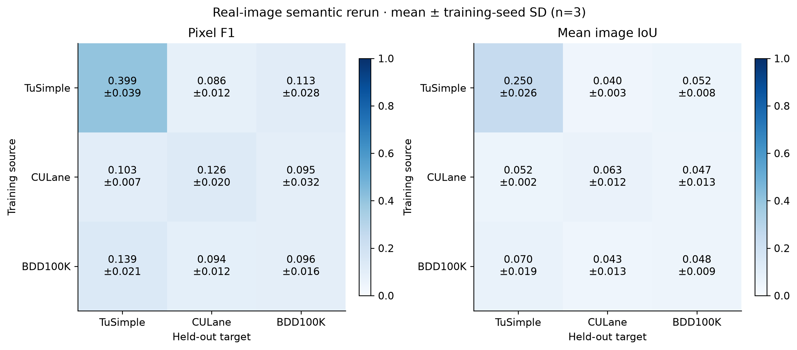
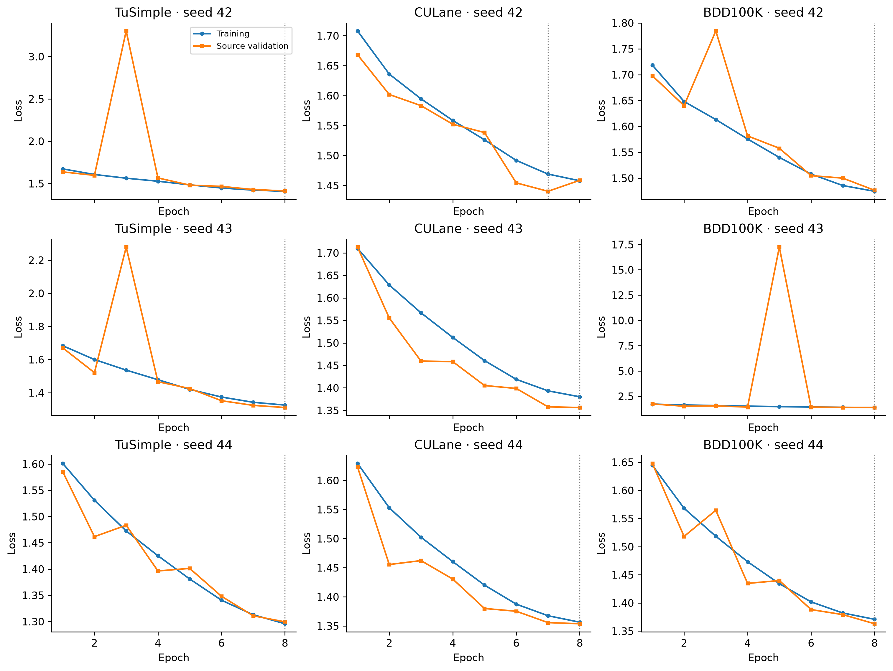
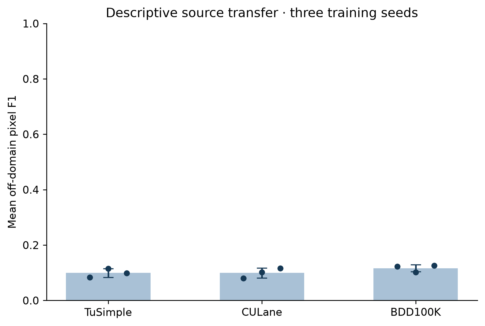

# Real-image cross-dataset semantic segmentation rerun

The rerun is complete: nine independently trained source/seed models and 27 frozen source-target evaluations on real benchmark images. All 1,080 evaluation probability maps and count records passed independent reconstruction checks.

The model is **LaneDG-Semantic-Reimplementation-v1**, with 1,141,793 trainable parameters. It is a documented semantic adaptation, not a verified reproduction of the cited YOLOv8n-LaneDG instance network. These results replace neither the provenance nor the architectural claims of the original manuscript automatically.

## Frozen protocol

Each benchmark contributes 80 training, 20 validation and 40 held-out evaluation images, with sampling seed 42 and disjoint declared sequence groups. BDD100K validation and evaluation use separate labeled val subsets. Training uses seeds 42, 43 and 44; eight epochs; 256×256 input; batch four; AdamW learning rate 0.001; weight decay 0.0005; three warm-up epochs and cosine decay; random initialization. All nine trainings finish before any target evaluation.

A source checkpoint minimizes source-validation loss, and its mask probability threshold maximizes source-validation pixel F1. Both are frozen across targets. Images are stretched directly to a square; lane coordinates are transformed and rasterized at three output pixels. BDD category exclusions, cubic-curve handling and ignored pixels are recorded in the preprocessing policy. See [data sources](../DATA_SOURCES.md), [QA audit](../qa/audit.json), and the [published execution protocol](../reproducibility/protocol.json).

## Three-seed results

Values are mean ± sample SD across three training seeds. These SDs are not confidence intervals.

| Source | Target | Pixel precision | Pixel recall | Pixel F1 | Mean image IoU |
|---|---|---:|---:|---:|---:|
| TuSimple | TuSimple | 0.310 ± 0.046 | 0.565 ± 0.010 | 0.399 ± 0.039 | 0.250 ± 0.026 |
| TuSimple | CULane | 0.066 ± 0.018 | 0.136 ± 0.040 | 0.086 ± 0.012 | 0.040 ± 0.003 |
| TuSimple | BDD100K | 0.084 ± 0.027 | 0.181 ± 0.031 | 0.113 ± 0.028 | 0.052 ± 0.008 |
| CULane | TuSimple | 0.061 ± 0.008 | 0.391 ± 0.179 | 0.103 ± 0.007 | 0.052 ± 0.002 |
| CULane | CULane | 0.076 ± 0.017 | 0.523 ± 0.329 | 0.126 ± 0.020 | 0.063 ± 0.012 |
| CULane | BDD100K | 0.055 ± 0.022 | 0.438 ± 0.151 | 0.095 ± 0.032 | 0.047 ± 0.013 |
| BDD100K | TuSimple | 0.087 ± 0.009 | 0.397 ± 0.220 | 0.139 ± 0.021 | 0.070 ± 0.019 |
| BDD100K | CULane | 0.060 ± 0.012 | 0.315 ± 0.179 | 0.094 ± 0.012 | 0.043 ± 0.013 |
| BDD100K | BDD100K | 0.057 ± 0.010 | 0.337 ± 0.134 | 0.096 ± 0.016 | 0.048 ± 0.009 |

## Conditional 95 percent intervals

Each checkpoint has 2,000 sequence-cluster percentile bootstrap resamples, with pooled pixel counts recomputed in each resample. Because selection takes one image per sequence group, each target has 40 groups. These intervals capture sampled-evaluation uncertainty conditional on the trained checkpoint. They do not include uncertainty from resampling training images, training seeds, unknown longer-drive relationships, or preprocessing choices.

Seed 42 is shown below; [the complete 27-cell CSV](metrics_by_seed.csv) contains all seeds, all four primary metrics, success-rate intervals and diagnostics.

| Source | Target | Pixel F1 [95% CI] | Mean image IoU [95% CI] |
|---|---|---:|---:|
| TuSimple | TuSimple | 0.354 [0.325, 0.384] | 0.220 [0.198, 0.242] |
| TuSimple | CULane | 0.074 [0.053, 0.097] | 0.038 [0.028, 0.050] |
| TuSimple | BDD100K | 0.093 [0.059, 0.130] | 0.046 [0.030, 0.065] |
| CULane | TuSimple | 0.101 [0.096, 0.105] | 0.053 [0.050, 0.055] |
| CULane | CULane | 0.107 [0.087, 0.126] | 0.058 [0.047, 0.068] |
| CULane | BDD100K | 0.060 [0.040, 0.081] | 0.032 [0.021, 0.044] |
| BDD100K | TuSimple | 0.158 [0.150, 0.167] | 0.090 [0.083, 0.099] |
| BDD100K | CULane | 0.086 [0.067, 0.105] | 0.047 [0.036, 0.059] |
| BDD100K | BDD100K | 0.087 [0.057, 0.121] | 0.052 [0.034, 0.073] |

## Foreground and negative-image diagnostics

Empty ground truth and empty prediction have image IoU 1. Consequently, an all-background model can obtain a nonzero mean image IoU. The table below exposes this baseline; pixel F1 for an all-background model is zero. Positive-only image IoU is averaged over images with annotated foreground, then across training seeds.

| Target | Positive evaluation images | Negative evaluation images | All-background mean image IoU |
|---|---:|---:|---:|
| TuSimple | 40 | 0 | 0.000 |
| CULane | 30 | 10 | 0.250 |
| BDD100K | 30 | 10 | 0.250 |

| Source | Target | Positive-only mean image IoU (three-seed mean) |
|---|---|---:|
| TuSimple | TuSimple | 0.250 |
| TuSimple | CULane | 0.053 |
| TuSimple | BDD100K | 0.069 |
| CULane | TuSimple | 0.052 |
| CULane | CULane | 0.084 |
| CULane | BDD100K | 0.063 |
| BDD100K | TuSimple | 0.070 |
| BDD100K | CULane | 0.057 |
| BDD100K | BDD100K | 0.064 |

## Training and interpretation

Mean off-domain pixel F1 across seeds:
- TuSimple: 0.099 ± 0.016.
- CULane: 0.099 ± 0.018.
- BDD100K: 0.117 ± 0.013.

Source ordering is descriptive for these sampled subsets and short runs. The study cannot establish that dataset diversity caused the observed ordering. Eight epochs and 80 training images may undertrain the model; annotation conventions, negative-image prevalence, sampling and the semantic adaptation can all affect transfer. There is no claim of convergence or state-of-the-art benchmark performance.

TuSimple clip IDs and CULane MP4 IDs are separated, but complete longer-drive linkage is unavailable. BDD filename prefixes are conservative groups, not independently verified recording identifiers. Perceptual-hash checking found no cross-role candidates at Hamming distance ≤4; it does not prove semantic or temporal independence.

The optional mask-IoU success rates are not AP/mAP. No detection boxes, instance matching, confidence-ranked precision-recall curves or NMS are used. Official benchmark lane-instance metrics are not claimed.

## Preserved provenance and outputs

The original checkpoints and aggregate histories were recovered, including a separate partial 500-epoch-configured TuSimple job saved at epoch nine. Real-image manifests and per-image evaluation records for those historical tables were not recovered. The current public source contains a synthetic generator. These findings do not establish how the original results were produced. See [recovery audit](../recovery/recovery_audit.json).

The exact pipeline source is available in this repository; selected image manifests and hashes are under `../manifests/`. Checkpoints, probability maps, and per-image predictions are not distributed. The [published verification record](../reproducibility/verification.json), [all seed metrics](metrics_by_seed.csv), and [three-seed summary](three_seed_summary.csv) are machine-readable. PNG and editable SVG figures are provided. Dataset images and annotations are not redistributed.
